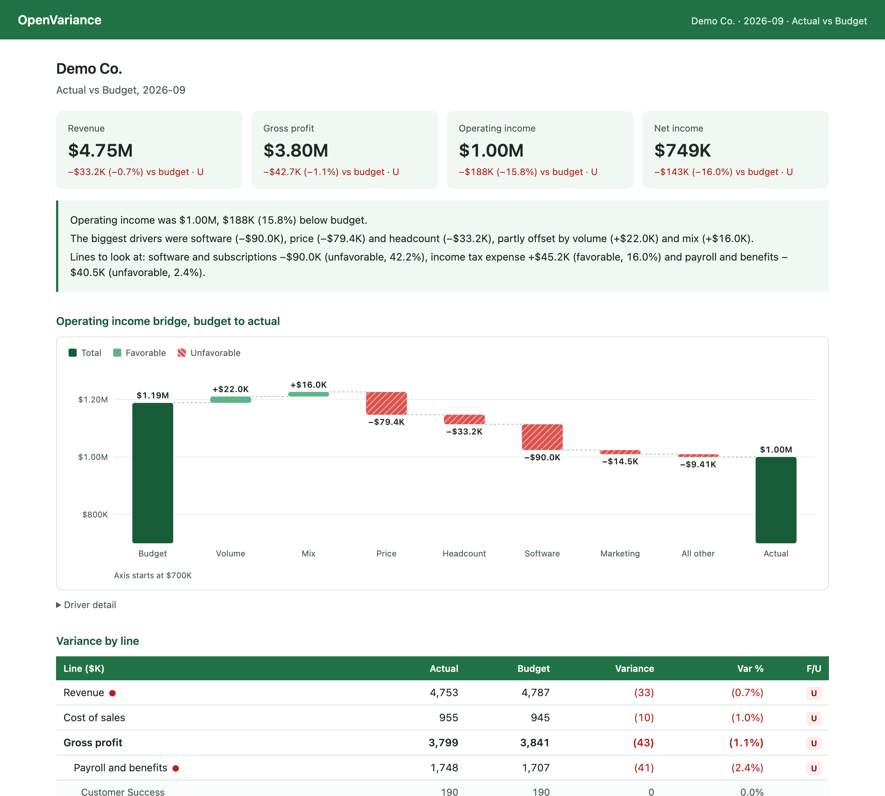

# OpenVariance

**Explain why your numbers moved.**

OpenVariance is an open source FP&A tool for budget vs. actual analysis. Give it a company's
numbers, and it tells you what changed, why it changed, and what it means for the rest of the
year. It also produces Excel workbooks and dashboards you can hand to a CFO.

[](https://github.com/wavebyrd/openvariance/actions/workflows/ci.yml)
[](LICENSE)




## What it does

- **Variance analysis.** Compare actual results with a budget, a forecast, the prior period, or
  another scenario, line by line. Each line gets a dollar variance, a percent variance and a
  favorable/unfavorable flag, with materiality thresholds and department drill-down.
- **Driver bridges that reconcile.** It splits a miss into its causes: volume, mix, price, unit
  cost, headcount, pay rate and each spend line. It uses Shapley attribution, so the pieces always
  add up exactly to the total and don't depend on which driver you look at first.
- **Three-statement forecasts.** It builds a driver-based income statement, balance sheet and cash
  flow statement with base, upside and downside cases. It checks that every period balances and
  that cash ties, and it never forces a balance with a plug.
- **Real public-company data.** Type a ticker and it pulls quarterly statements from SEC EDGAR for
  free. It removes duplicate and restated values, turns year-to-date figures into quarters,
  derives Q4 from the annual report, and ties the balance sheet to the filed totals.
- **Messy private-company files.** It reads QuickBooks, Xero and NetSuite style exports, budget
  spreadsheets and GL dumps. It skips subtotals, handles "in thousands" and accounting number
  formats, suggests an account mapping with reasons, and ties the result back to the file's own
  totals.
- **Excel output.** Workbooks use live formulas, blue inputs and check cells that read 0, so a
  finance team can audit them. The test suite recalculates the exported model with an independent
  formula engine to prove it matches the Python engine.
- **Built for AI agents.** A local MCP server lets Claude, ChatGPT, Cursor and other agents use
  every feature. The engine does all the math, so an agent can't make up a number.

## Try it in one minute

You need [uv](https://docs.astral.sh/uv/) (or Python 3.10+ and pip).

```bash
uvx --from git+https://github.com/wavebyrd/openvariance openvariance demo --open
```

This runs September 2026 for **Demo Co.**, a fictional software company. It prints the variance
report and bridge, opens the dashboard, and writes three files: a variance workbook, a forecast
model, and the dashboard.

```
Operating income bridge (drivers, Shapley)
  Budget                                  $1.19M
  Software                               −$90.0K  $303,200 vs $213,200
  Price                                  −$79.4K  average price at actual mix: $447.51 vs $454.94
  Headcount                              −$33.2K  124 vs 122 FTE-months (Engineering +2)
  Volume                                 +$22.0K  10,622 units vs 10,561
  Mix                                    +$16.0K  unit share: Enterprise 4.8% vs 4.9%; Pro 40.5% vs 39.2%; ...
  ...
  Actual                                  $1.00M   reconciles exactly
```

## Use it with an AI agent

OpenVariance runs as a local [MCP](https://modelcontextprotocol.io) server. Your agent app starts
it when it needs it. There's nothing to host, and your files stay on your computer. Numbers the
tools return become part of your conversation with the AI provider, the same as pasting them into
a chat.

**Claude Code**

```bash
claude mcp add openvariance -- uvx --from git+https://github.com/wavebyrd/openvariance openvariance mcp
```

**Claude Desktop, Cursor and other MCP clients**

```json
{
  "mcpServers": {
    "openvariance": {
      "command": "uvx",
      "args": ["--from", "git+https://github.com/wavebyrd/openvariance", "openvariance", "mcp"]
    }
  }
}
```

Then ask something like *"Load the demo and tell me why operating income missed budget in
September,"* or *"Here's our P&L export and budget. How did we do last month?"* See
[docs/agents.md](docs/agents.md) for the tool list and the rules the server gives agents.

## Use your own data

```bash
# 1. See how a file will be read, and save suggested account mappings to review
openvariance inspect examples/demo_budget_2026.xlsx --write-mapping budget_map.json

# 2. Compare actuals with the budget, and write Excel and a dashboard
openvariance variance \
  --actual examples/demo_pl_quickbooks_2026.csv \
  --budget examples/demo_budget_2026.xlsx --baseline-mapping budget_map.json \
  --period 2026-09 --excel september.xlsx --dashboard september.html --open
```

Only high-confidence mappings are applied automatically. Every other account is listed for you to
confirm, and nothing is used until it maps and ties out. See [docs/importing.md](docs/importing.md).

Add `--actual-drivers` and `--baseline-drivers` (units, prices, headcount and pay rates) to get a
driver bridge instead of a line-item bridge. Add `--ytd` for year to date.

## Public companies

SEC asks automated clients to identify themselves, so set a name and email once:

```bash
export OPENVARIANCE_SEC_USER_AGENT="Jane Doe jane@example.com"
openvariance sec CRWV                               # quarterly statements, $M
openvariance forecast --ticker CRWV --excel crwv_model.xlsx
```

## How the numbers work

Short version below. Full detail and worked examples are in
[docs/methodology.md](docs/methodology.md).

- **Sign convention.** Variance = (actual − baseline) × direction. Positive is always favorable.
  Revenue above budget is +, and costs above budget are −.
- **Percent variance** is variance ÷ |baseline|, so a shrinking loss reads as favorable. It shows
  `n/m` when the baseline is zero.
- **Stocks vs. flows.** Revenue and cash flows add up across periods. Balance sheet lines take the
  last period. Totals are always derived from their parts, never stored.
- **Attribution.** Shapley values are computed in exact rational arithmetic, then rounded to cents
  with the largest-remainder method, so the rounded bridge still ties to the cent.
- **Missing data stays missing.** A line with no data shows "—", not zero, and the reason is noted.
- **No plugs.** The forecast's cash comes from the cash flow statement. If an opening balance sheet
  doesn't balance, the gap is reported, not hidden.

## Python API

```python
from openvariance import compare, explain, demo
from openvariance.forecast import infer_assumptions, default_scenarios, run_scenarios

d = demo.load()
report = compare(d.actual, d.budget, ["2026-09"])
bridge = explain(d.budget_drivers["2026-09"], d.actual_drivers["2026-09"])
print(report.headline.impact, bridge.reconciles)

base = infer_assumptions(d.history).assumptions
results = run_scenarios(d.history, default_scenarios(base, 12), periods=12)
```

## Project layout

```
src/openvariance/
  accounts.py      standard chart of accounts, sign conventions
  dataset.py       FinancialData: amounts by period, line, department
  variance.py      line-by-line comparison
  attribution.py   Shapley attribution and reconciling bridges
  drivers.py       volume/mix/price and headcount/rate driver model
  forecast.py      linked three-statement forecast and scenarios
  sec.py           SEC EDGAR loader and XBRL normalization
  importers/       file inspection, account mapping, tie-outs
  excel.py         formula-driven workbooks
  dashboard.py     self-contained HTML dashboard
  mcp_server.py    tools for AI agents
  cli.py           the openvariance command
```

## Roadmap

- Rolling forecasts with saved versions, and forecast accuracy tracking over time
- A GitHub Action that grades a public-company forecast against each new 10-Q
- Headcount planning (hires, start dates, raises) feeding payroll drivers
- Multi-level headers and more accounting-system presets
- A browser app on top of the same engine

## Contributing

Issues and pull requests are welcome. Start with [CONTRIBUTING.md](CONTRIBUTING.md). The one rule
that matters most: every number has to tie, and every new calculation needs a test that proves it.

## License

MIT. See [LICENSE](LICENSE). Demo Co. is fictional. OpenVariance is a tool for analysis, not
financial or investment advice.
